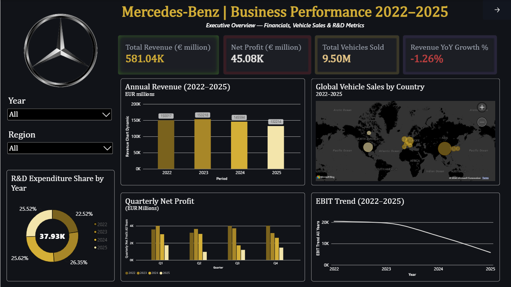
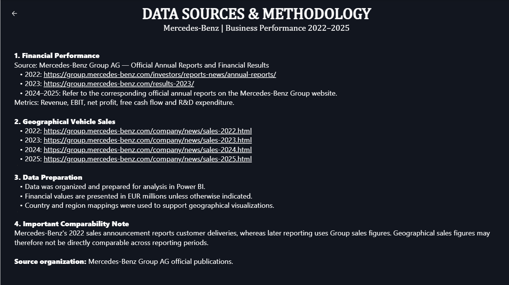

# 🚘 Mercedes-Benz Business Performance Dashboard (2022–2025)

## 📌 Project Overview

The **Mercedes-Benz Business Performance Dashboard** is an interactive business intelligence project developed using Microsoft Power BI to analyze Mercedes-Benz's financial performance and geographical vehicle sales from 2022 to 2025.

The dashboard provides insights into key financial indicators, annual revenue trends, quarterly profitability, research and development expenditure, and global vehicle sales through interactive visualizations.

It features a premium **Gold & Black dashboard theme** inspired by Mercedes-Benz's luxury brand identity.

## 🎯 Project Objectives

- 📊 Analyze annual revenue and net profit.
- 📈 Track EBIT trends across 2022–2025.
- 🚗 Explore geographical vehicle sales across different regions.
- 🔬 Analyze research and development expenditure.
- 📅 Compare quarterly net profit across multiple years.
- 🎛️ Enable interactive data exploration using Year and Region slicers.

## 🛠️ Tools & Technologies

- **Microsoft Power BI** — Dashboard development and visualization.
- **Power Query** — Data preparation and transformation, where applicable.
- **DAX** — Measures and calculations, where applicable.
- **Mercedes-Benz Group Publications** — Reference sources for financial and vehicle sales information.

## 📊 Dashboard Highlights

### 💰 Key Performance Indicators (KPIs)

- Total Revenue
- Net Profit
- Total Vehicles Sold
- Revenue Year-over-Year (YoY) Growth

### 📈 Business Visualizations

- Annual Revenue (2022–2025)
- Global Vehicle Sales by Country
- R&D Expenditure Share by Year (Donut Chart)
- Quarterly Net Profit Comparison
- EBIT Trend (2022–2025)

### 🎛️ Interactive Features

- Year slicer for filtering the reporting period.
- Region slicer for exploring geographical sales.
- Interactive charts and map visualizations.
- Dynamic KPI calculations based on report filters.

## 🖼️ Dashboard Preview

### 🚘 Main Dashboard

### 📚 Data Sources & Methodology

## 🎨 Dashboard Design

The report uses a premium Gold & Black visual theme to create a luxury automotive-inspired dashboard.

- 🖤 Dark background for a professional appearance.
- 🥇 Gold accents for financial visualizations.
- 📊 Consistent chart styling and KPI cards.
- ✨ Clean layout with clear visual hierarchy.

## 📚 Data Sources

The project references official Mercedes-Benz Group publications.

### 🚗 Vehicle Sales

- [2022 Vehicle Sales](https://group.mercedes-benz.com/company/news/sales-2022.html)
- [2023 Vehicle Sales](https://group.mercedes-benz.com/company/news/sales-2023.html)
- [2024 Vehicle Sales](https://group.mercedes-benz.com/company/news/sales-2024.html)
- [2025 Vehicle Sales](https://group.mercedes-benz.com/company/news/sales-2025.html)

### 💰 Financial Information

- [Mercedes-Benz Annual Reports](https://group.mercedes-benz.com/investors/reports-news/annual-reports/)
- [2023 Financial Results](https://group.mercedes-benz.com/results-2023/)

See the [`documentation/`](documentation/) folder for additional details about data sources, preparation, methodology, and limitations.

## 🚀 How to Use

1. Download `Mercedes_Benz_Business_Performance.pbix` from this repository.
2. Install or open Microsoft Power BI Desktop.
3. Open the downloaded `.pbix` file.
4. Use the Year and Region slicers to explore the report.
5. Navigate to the Data Sources page to review the reference links and methodology.

## ⚠️ Data Notes & Limitations

- The dashboard covers the 2022–2025 reporting period.
- Financial values are presented in EUR millions unless otherwise indicated.
- Financial and sales figures should be interpreted according to their original reporting definitions.
- Mercedes-Benz's 2022 sales announcement reports customer deliveries, whereas subsequent reporting uses Group sales figures. Geographical figures may therefore not be directly comparable across reporting periods.
- Refer to the official publications for original definitions and reported values.
- Dashboard calculations and figures should be validated against their underlying source data.

## 🎓 Skills Demonstrated

Power BI · Data Visualization · Business Analytics · Data Preparation · DAX · KPI Reporting · Financial Trend Analysis · Interactive Dashboard Design

## 👨‍💻 Author

**Pranav Chinnawar**

- [GitHub Profile](https://github.com/pranavchinnawar)

## ⭐ Support

If you find this project useful, consider giving the repository a ⭐ on GitHub!

---

*This project was developed for learning, portfolio development, and data analytics practice. It is an independent project and is not affiliated with or endorsed by Mercedes-Benz Group AG.*
